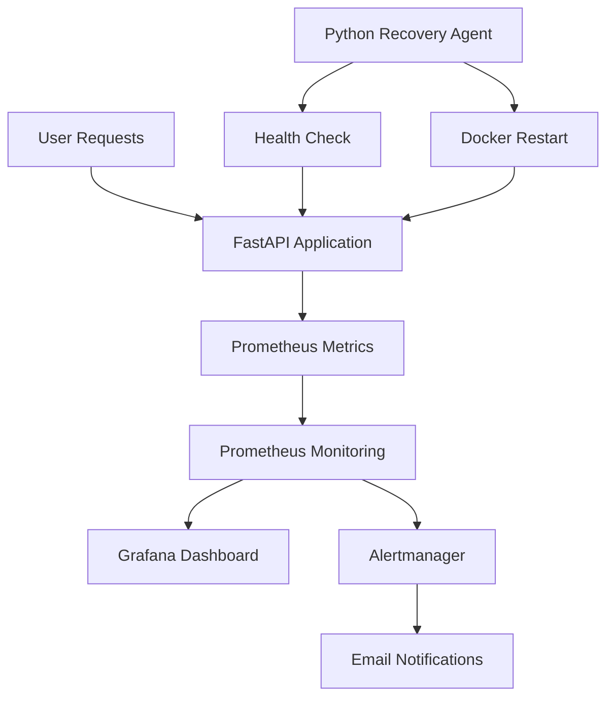

# Automated Log Monitoring & Self-Healing System

A practical Application Support project that monitors application health, tracks HTTP requests and errors, sends email alerts, and automatically recovers an unhealthy application using Docker.

## Project Overview

This project demonstrates how an Application Support Engineer can monitor an application, identify failures, receive alerts, and automate basic recovery operations.

## Architecture



The monitoring and alerting pipeline operates independently from the Python recovery agent, which performs its own health checks.

## Technologies Used

- Python
- FastAPI
- Docker and Docker Compose
- Prometheus
- Grafana
- Alertmanager
- SMTP Email Notifications
- Windows PowerShell

## Key Features

### 1. Application Monitoring
- Application health endpoint.
- HTTP request tracking.
- Application error tracking.
- Prometheus metrics collection.

### 2. Grafana Dashboard

Seven monitoring panels:

- Application Status
- Application Uptime
- Total HTTP Requests
- Total Application Errors
- HTTP 5xx Error Rate
- HTTP Request Traffic
- HTTP 4xx Error Rate

### 3. Alerting System
- Prometheus alert rules.
- Application downtime detection.
- HTTP 5xx error-rate monitoring.
- Alertmanager email notifications.
- Firing and resolved alert notifications.

### 4. Self-Healing System

A Python recovery agent:

- Checks application health every 10 seconds.
- Detects three consecutive failed health checks.
- Restarts the Docker application container.
- Verifies application recovery.
- Records recovery activity in a log file.

The recovery agent runs separately on the host machine.

## Project Structure

```text
automated-log-monitoring/
│
├── app/
│   ├── main.py
│   ├── Dockerfile
│   └── requirements.txt
│
├── monitoring/
│   ├── prometheus.yml
│   ├── alert_rules.yml
│   └── alertmanager.yml
│
├── recovery/
│   └── recovery_agent.py
│
├── docker-compose.yml
├── .gitignore
└── README.md
```

## Application Endpoints

| Endpoint | Purpose |
|---|---|
| `/` | Application home |
| `/health` | Health check |
| `/work` | Simulates normal application work |
| `/simulate-error` | Simulates an HTTP 500 error |
| `/metrics` | Exposes Prometheus metrics |

## Setup and Execution

### Prerequisites

- Docker Desktop
- Docker Compose
- Python 3

### Start the application

Clone the repository:

```bash
git clone https://github.com/Vigneshs9899/automated-log-monitoring.git
cd automated-log-monitoring
```

### Configure Gmail SMTP credentials

Before starting Docker Compose:

1. Create a file named `smtp_password.txt` in the project root.
2. Add your Gmail App Password to this local file.
3. Save the file.

**Important:** Never upload `smtp_password.txt` to GitHub. It is already excluded through `.gitignore`.

Use your own Gmail SMTP configuration in `monitoring/alertmanager.yml`.